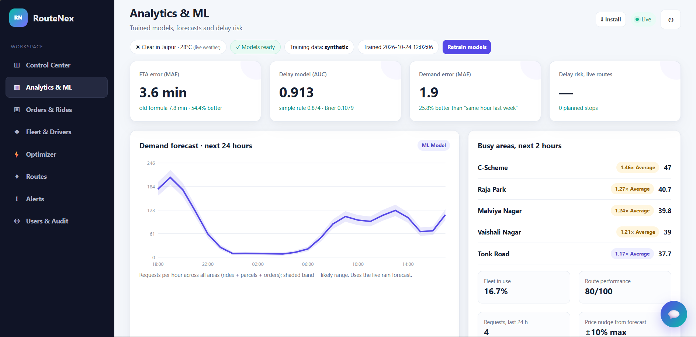
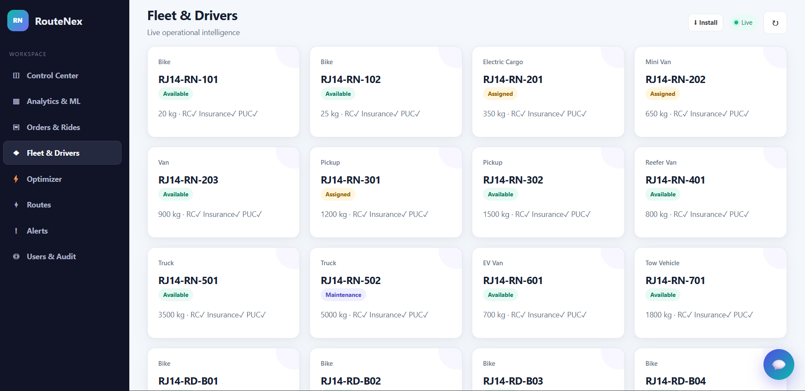
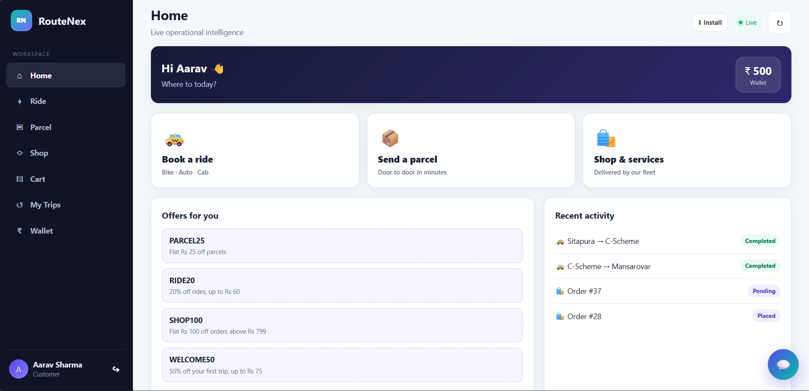
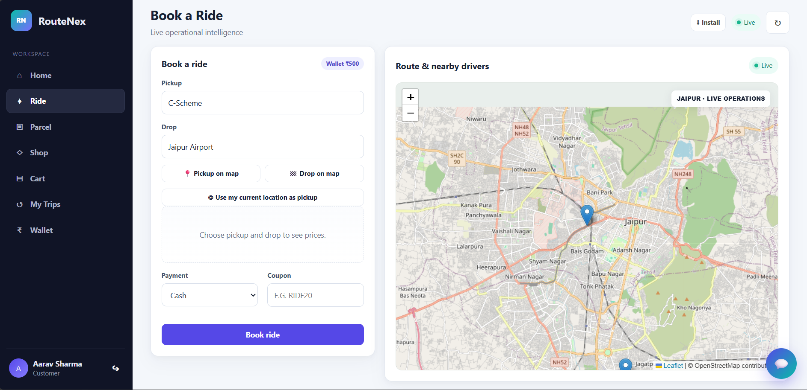
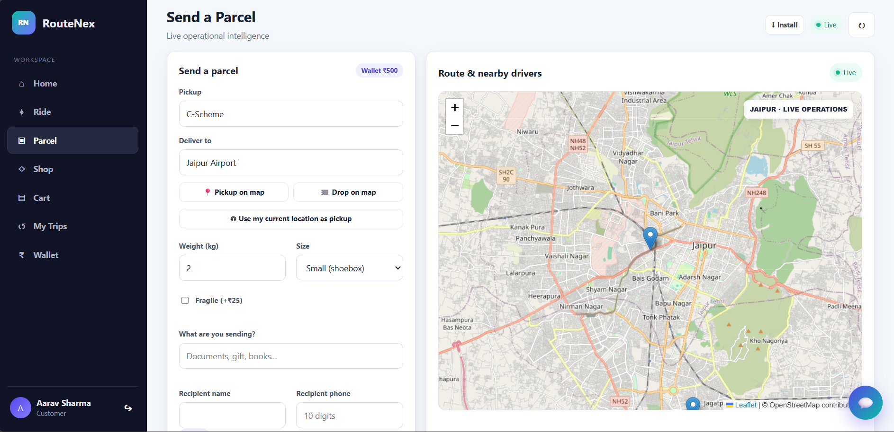
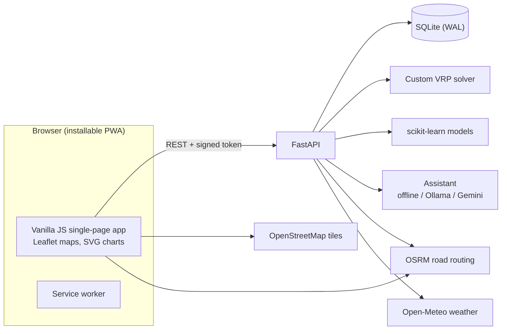

<div align="center">

# 🚚 RouteNex

### Dynamic Logistics Routing & Fleet Coordination Hub

Rides, parcels and a student shop on one platform, with a custom route optimizer, machine-learning ETAs and a safe, confirm-first AI assistant.

[](https://routenex.onrender.com)


</div>

---

## ✨ What is RouteNex?

RouteNex is a full-stack capstone project that brings three everyday services together and runs them from one fleet:

* 🚕 **Rides** (bike, auto, cab) with live road routing, nearby drivers, demand-aware fares and OTP-secured trips
* 📦 **Parcels** with pickup and delivery OTPs, weight and size based pricing
* 🛒 **A student shop** with 160+ real-world items (stationery, books, electronics, hostel and kitchen needs, groceries and more)

Behind the screens there is a **custom vehicle-routing optimizer**, **three trained ML models** (ETA, delay risk, demand forecast) and an **AI assistant** that can look things up and, only after you press *Confirm*, book or cancel for you.

> **Honest by design:** the ML models are trained on realistic *synthetic* Jaipur data, payments (UPI/card) are simulated, and demo drivers are driven by an autopilot. Every one of these is labelled inside the app.

## 📸 Screenshots

| Control room: Analytics & ML | Fleet & Drivers |
|:--:|:--:|
|  |  |

| Customer home | Book a ride | Send a parcel |
|:--:|:--:|:--:|
|  |  |  |

## 🧩 Features

| Role | What they can do |
|---|---|
| **Customer** | Book rides and parcels, shop and check out, wallet top-up, coupons, live tracking, ratings, ride and order history, AI assistant |
| **Driver** | Online/offline switch, job console with OTP start and finish, delivery route with stops and cash to collect, earnings (today / week / total), busy-area hints |
| **Dispatcher** | Route optimizer (preview, then apply), live routes map, alerts, dynamic rerouting after a breakdown |
| **Fleet manager** | Vehicles and drivers, documents, availability, maintenance status |
| **Admin** | Everything above plus users, audit trail, analytics and ML dashboard, model retraining |

### 🧠 Route optimizer
A purpose-built solver (`backend/services/vrp.py`, pure Python, no OR-Tools):
* capacitated VRP with **soft time windows**, **priorities**, vehicle cost per km and shift limits
* priority-ordered **cheapest insertion**, then **2-opt, relocate and swap** local search
* uses real road distances from OSRM when online, with a safe straight-line fallback
* every plan shows **before vs after** against the old nearest-neighbour planner (distance, lateness, cost, vehicles used)
* **dynamic rerouting:** report a breakdown and the released orders are re-planned immediately

### 📈 Machine learning (`ml/`)
Three scikit-learn gradient-boosting models trained with **temporal validation** (train on earlier days, test on the last days):

| Model | Predicts | Baseline it must beat |
|---|---|---|
| ETA | trip / delivery minutes, with plain-language reasons ("Heavy traffic +4 min") | the old distance / speed formula |
| Delay risk | probability that a delivery window is missed, per stop | base rate and the "less slack = riskier" rule |
| Demand | requests per area per hour, 24 h forecast | same hour last week |

A new model is promoted only if it passes its **quality gate**; otherwise the previous one stays live. If scikit-learn or the artifacts are missing, the app falls back to formulas and keeps working.

### 🤖 AI assistant
Works fully offline with a built-in rule engine, or with a local **Ollama** model or **Gemini** (optional). The model only *chooses a tool*; tools are **role-gated**, phone numbers and e-mails are **redacted** before anything leaves the machine, and anything that changes data needs an explicit **Confirm**.

### 🔐 Security
PBKDF2 password hashing (210,000 rounds), signed expiring tokens, role-based access control with ownership checks, rate limiting on login / OTP / assistant, hashed expiring OTPs, a strict Content-Security-Policy, an audit trail, and secrets read from the environment (never from code).

### 📱 PWA
Installable on phones, offline app shell, network-first updates, and API responses are never cached.

## 🏗️ Architecture



## 📁 Project structure

```text
RouteNex/
├── backend/            FastAPI app
│   ├── app.py          entry point, security headers, routers
│   ├── routers/        auth, shop, rides, driver, fleet, ops, wallet, ml, assistant
│   ├── services/       trips, pricing, vrp, roads, weather, mlserve, catalog, assistant, llm ...
│   └── tests/          pytest suite
├── frontend/           single-page app (HTML, CSS, vanilla JS) + service worker
├── ml/                 data generator, features, training and promotion gates
├── database/           schema, demo seed, admin and reset tools
├── docs/               architecture, API and security notes, screenshots
├── Dockerfile  docker-compose.yml
└── setup.bat  start.bat  start-phone.bat  preflight.bat  reset_demo.bat
```

## 🚀 Run it locally

### Windows (easiest)
1. Install **Python 3.12** (`winget install -e --id Python.Python.3.12`).
2. Double-click **`setup.bat`** (one time, needs internet).
3. Open `backend\.env` and set your own admin password: `ADMIN_PASSWORD=your-password` (and a long random `ROUTENEX_SECRET`).
4. Double-click **`start.bat`** and open <http://localhost:8000>. API docs are at `/docs`.

Handy extras: `start-phone.bat` (public HTTPS link for testing on a phone via Cloudflare Tunnel), `preflight.bat` (pre-demo checklist), `reset_demo.bat` (clean demo data).

### Any OS
```bash
python -m venv .venv && source .venv/bin/activate        # Windows: .venv\Scripts\activate
pip install -r backend/requirements-dev.txt
cp backend/.env.example backend/.env                      # then edit it
python database/seed.py --reset
cd backend && uvicorn app:app --reload
```

### Docker
```bash
export ROUTENEX_SECRET="a-random-string-of-at-least-32-characters"
export ADMIN_PASSWORD="choose-your-own"
docker compose up --build
```

### Run the tests
```bash
pytest
```
The suite covers auth and rate limits, role permissions, ride and parcel lifecycles, wallet and coupons, the optimizer and ML pipeline, the assistant, the PWA files and the shop catalogue.

## 🔑 Demo accounts

| Role | Email | Password |
|---|---|---|
| Customer | `customer@routenex.in` | `Demo@123` |
| Driver | `driver@routenex.in` | `Demo@123` |
| Dispatcher | `dispatcher@routenex.in` | `Demo@123` |
| Fleet manager | `fleet@routenex.in` | `Demo@123` |

The login screen also offers a **Google demo** profile and a **Mobile OTP** demo (number and code are pre-filled). The **admin** account is private: it is created from the `ADMIN_*` environment variables and is not part of the public demo.

## ⚙️ Configuration

All settings are environment variables (or `backend/.env`). The important ones:

| Variable | Purpose |
|---|---|
| `ROUTENEX_ENV` | `development` (default) or `production` (requires a 32+ character secret) |
| `ROUTENEX_SECRET` | signs login tokens. **Always set your own long random value** |
| `ROUTENEX_DB` | SQLite file path |
| `ADMIN_NAME`, `ADMIN_EMAIL`, `ADMIN_PASSWORD` | the owner/admin login, created or updated on every start |
| `DEMO_MODE` | demo OTP, demo Google profile and demo fleet/wallet credit |
| `DEMO_AUTOPILOT` | simulated drivers move and finish trips by themselves |
| `LLM_PROVIDER` | `auto`, `ollama`, `gemini` or `offline` |
| `GEMINI_API_KEY`, `OLLAMA_MODEL` | optional assistant back-ends |
| `CORS_ORIGINS` | allowed browser origins |

## ☁️ Deploying

The repository includes a `Dockerfile` that seeds demo data on first start and listens on `$PORT`, so it works on Render, Railway, Fly.io or any Docker host. Set `ROUTENEX_SECRET` and the `ADMIN_*` variables in the host's environment settings and use `/api/health` as the health check.

> SQLite lives on the container's disk, so on free hosting tiers the data resets when the service restarts. For real use, move to PostgreSQL, Redis-backed rate limiting, a real SMS provider and verified Google sign-in.

## 🗺️ Roadmap
- PostgreSQL and Redis for multi-worker deployments
- Real payment gateway and SMS provider adapters
- GPS ingestion over WebSockets
- Training the models on real trip data (`ml/data.py` has the hook)

## 👤 Author

**Sami**, built RouteNex end to end: backend, optimizer, ML pipeline, assistant and UI.

[](mailto:samikhan57705@gmail.com)
[](https://www.linkedin.com/in/samikhan07)
[](https://github.com/samikhan7507)
[](https://samikhan7507.github.io/Sami-portfolio/)

If you like the project, a ⭐ on the repository is much appreciated.
